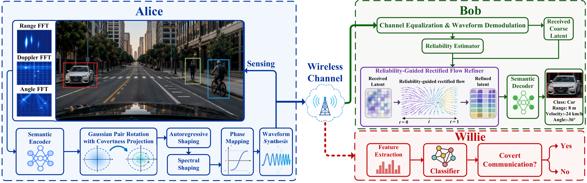
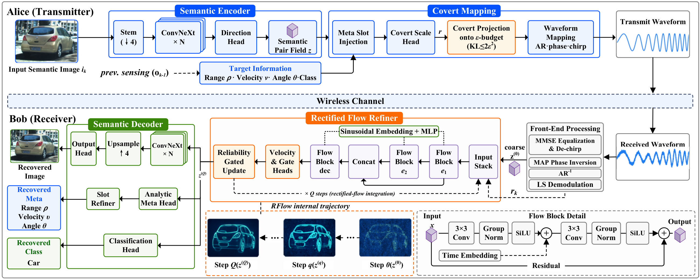

<h1 align="center">CoSMIC: Hiding Semantics in ISAC</h1>

<h3 align="center">Covert Communication over Dual-Functional Waveforms<br>with Rectified Flow-Assisted Recovery</h3>

<p align="center">
  <a href="https://arxiv.org/abs/2607.25354"></a>
  
  
  
</p>

<p align="center">
  <a href="https://arxiv.org/abs/2607.25354">Paper</a> •
  <a href="#overview">Overview</a> •
  <a href="#system-model">System Model</a> •
  <a href="#cosmic-network">CoSMIC Network</a> •
  <a href="#demo">Demo</a> •
  <a href="#getting-started">Getting Started</a> •
  <a href="#citation">Citation</a>
</p>

Official implementation of the paper
[**“Covert Semantic Transmission in ISAC: Dual-Functional Waveform Design and Rectified Flow-Assisted Recovery”**](https://arxiv.org/abs/2607.25354).

---

## Overview

**CoSMIC** (**C**overtness-**o**riented **S**emantic **M**odulation in **I**SAC **C**hirps) hides a semantic transmission inside an ordinary sensing waveform and jointly addresses **covertness**, **sensing fidelity**, and **semantic accuracy**. The sensing output of each frame is embedded into the dual-functional chirp of the next frame, and the radiated signal remains statistically indistinguishable from a sensing-only probe.

- **Semantic rotation coding.** Semantic latents are mapped onto the pairwise rotation and scaling of shared Gaussian reference pairs under a constant-modulus waveform.
- **Multi-frame covertness guarantee.** A closed-form Kullback–Leibler bound over an arbitrary observation window is enforced by a differentiable budget projection.
- **Sensing performance preservation.** The matched-filter mainlobe response stays invariant and the output SINR stays bounded under the semantic embedding.
- **Reliability-guided RFlow refiner.** A rectified flow on the unit circle transports the coarse latent toward the clean latent within two steps.

On the [View-of-Delft automotive dataset](https://github.com/tudelft-iv/view-of-delft-dataset), CoSMIC improves the semantic reconstruction quality by up to **18%** over diffusion-based baselines under strict covertness constraints.

---

## System Model

<p align="center">
  
</p>

CoSMIC operates on a frame basis with three parties.

- **Alice** (dual-functional transmitter) probes the scene with a chirp-based ISAC waveform and estimates the target range, velocity, angle, and class from the echoes.
- **Bob** (legitimate receiver) shares a secret seed with Alice and recovers the scene image and the target states from the waveform.
- **Willie** (warden) tests the sensing-only mode $H_0$ against the covert SemCom mode $H_1$ over a window of frames with an arbitrary detector.

The sensing output $`\mathbf{o}_{k-1}`$ of one frame forms the semantic message of the next frame,

```math
\mathbf{m}_k=\Phi\left(\mathbf{o}_{k-1}\right)=\left[\mathbf{i}_k,\boldsymbol{\varsigma}_k\right],
```

where $`\mathbf{i}_k`$ is the scene image and $`\boldsymbol{\varsigma}_k`$ stacks the target range, velocity, angle, and class.

---

## CoSMIC Network

<p align="center">
  
</p>

### Transmitter: covert dual-functional waveform generation

Each frame of $M$ chirps with $N$ samples per chirp carries $J=MN/2$ Gaussian reference pairs $`\mathbf{q}_{k,j}\sim\mathcal{N}(\mathbf{0},\mathbf{I}_2)`$ expanded frame by frame from the secret seed. The semantic encoder maps $`\mathbf{m}_k`$ to the pair parameters $`(c_{k,j},s_{k,j})`$, which rotate the reference vector as

```math
\mathbf{b}_k^{(0)}=\mathbf{q}_k,\qquad
\mathbf{b}_k^{(1)}=\mathbf{A}_k\mathbf{q}_k,\qquad
\mathbf{A}_{k,j}=\begin{bmatrix}c_{k,j} & -s_{k,j}\\ s_{k,j} & c_{k,j}\end{bmatrix},
```

where mode $0$ is the sensing-only probe, mode $1$ is the covert SemCom mode, and $`\tau_{k,j}=c_{k,j}^{2}+s_{k,j}^{2}`$ is the pair scale.

**Multi-frame covertness constraint.** With $\chi(t)=t-\ln t-1$, the joint distributions $`P_{0}^{(K)}`$ and $`P_{1}^{(K)}`$ of the observations at Willie over an arbitrary window of $K$ consecutive frames satisfy

```math
D\left(P_{1}^{(K)}\,\middle\Vert\,P_{0}^{(K)}\right)\le\mathbb{E}\left[\sum_{k=1}^{K}\sum_{j=1}^{J}\chi(\tau_{k,j})\right],
\qquad
\sum_{k=1}^{K}\sum_{j=1}^{J}\chi(\tau_{k,j})\le 2\epsilon^{2}
\;\Longrightarrow\;
\xi^{(K)}\ge 1-\epsilon,
```

where $`\xi^{(K)}`$ is the total detection error probability of Willie. The rotation angles are absent from the bound and carry the semantics free of covertness cost.

**Covert projection.** The budget $2\epsilon^{2}$ is allocated evenly over a monitoring window of $`K_{\mathrm{W}}`$ frames, and each frame meets its share by contracting the raw scales $`\tilde{\tau}_{k,j}`$ toward unity,

```math
\tau_{k,j}=1+\lambda_k(\tilde{\tau}_{k,j}-1),\qquad
\lambda_k=\sup\left\lbrace\lambda\in[0,1]:\sum_{j=1}^{J}\chi\left(1+\lambda(\tilde{\tau}_{k,j}-1)\right)\le\frac{2\epsilon^{2}}{K_{\mathrm{W}}}\right\rbrace,
```

where $`\lambda_k`$ is found by bisection and treated as a constant in the backward pass.

**Waveform synthesis.** The symbol vector is shaped, mapped to phases, and modulated onto the chirp $`p_n=\exp\left(j\pi\mu n^{2}/N\right)`$,

```math
\mathbf{u}_k^{(i)}=\mathbf{G}_{\rho}\mathbf{b}_k^{(i)},\qquad
\phi_{k,m,n}^{(i)}=\pi\tanh\left(\alpha_{\phi}u_{k,m,n}^{(i)}\right),\qquad
x_{k,m,n}^{(i)}=p_n\,e^{j\phi_{k,m,n}^{(i)}},
```

which keeps a constant envelope and identical radiated power in both modes.

### Receiver: reliability-guided RFlow refiner

Bob equalizes the received frame, inverts the phase mapping and the shaping, and projects onto the shared reference pairs, which yields the coarse pair angles $`\boldsymbol{\theta}_k^{(0)}`$ and the reliability features $`\mathbf{r}_k`$. The pair angles live on the torus $`\mathbb{T}^{J}=(\mathcal{S}^{1})^{J}`$ with $`\mathrm{Log}_{a}(b)=\mathrm{w}(b-a)`$ and $`\mathrm{Exp}_{a}(v)=\mathrm{w}(a+v)`$, where $\mathrm{w}(\cdot)$ wraps an angle into $[-\pi,\pi)$. The RFlow refiner transports the coarse angles toward the clean angles $`\boldsymbol{\theta}_k^{\star}`$ along the geodesic bridge

```math
\boldsymbol{\theta}_{k,t}=\mathrm{Exp}_{\boldsymbol{\theta}_k^{(0)}}\left(t\,\boldsymbol{\Delta}_k\right),\qquad
\boldsymbol{\Delta}_k=\mathrm{Log}_{\boldsymbol{\theta}_k^{(0)}}\left(\boldsymbol{\theta}_k^{\star}\right),\qquad t\in[0,1],
```

and a velocity field $`\mathbf{v}_{\Psi}`$ conditioned on $`\mathbf{r}_k`$ is trained by flow matching toward the constant velocity $`\boldsymbol{\Delta}_k`$. At inference, $Q$ explicit steps are taken on the torus,

```math
\boldsymbol{\theta}_k^{(q+1)}=\mathrm{Exp}_{\boldsymbol{\theta}_k^{(q)}}\left(\frac{1}{Q}\,\mathbf{v}_{\Psi}\left(\boldsymbol{\theta}_k^{(q)},\frac{q}{Q},\mathbf{r}_k\right)\right),\qquad q=0,\ldots,Q-1,
```

where each step rotates every pair and keeps the unit modulus. Two steps ($Q=2$) suffice, and the refined latent is decoded into the scene image and the target range, velocity, angle, and class.

The full implementation lives in [`cosmic_main/`](cosmic_main).

---

## Demo

Closed-loop reception at Bob on the [View-of-Delft dataset](https://github.com/tudelft-iv/view-of-delft-dataset) (Rayleigh channel, covert budget $\epsilon=0.10$). Each animation shows the ground-truth scene next to the semantics recovered by Bob from the covert waveform, with a zoomed target crop and the recovered range / velocity / angle / class against the ground truth.

<p align="center">
  
</p>

<p align="center">
  
</p>

<p align="center">
  
</p>

<p align="center">
  
</p>

---

## Getting Started

Requires Python 3.10+, PyTorch 2.x with CUDA, and the [View-of-Delft dataset](https://github.com/tudelft-iv/view-of-delft-dataset) under `cosmic_main/dataset/VoD/view_of_delft_PUBLIC` (or pass `--vod-root`).

### Train

```bash
python main.py --mode train
```

### Test

```bash
python main.py --mode test --snrs 0 5 10 15 20
```

---

## Citation

If you find this work useful, please cite:

```bibtex
@article{bai2026cosmic,
  author  = {Yunfan Bai and Yuwen Qian and Cheng Zeng and Zhen Mei and
             Zhaohui Yang and Wei Zhu and Shuning Zhang and Feng Shu},
  title   = {Covert Semantic Transmission in {ISAC}: Dual-Functional Waveform
             Design and Rectified Flow-Assisted Recovery},
  journal = {arXiv preprint arXiv:2607.25354},
  month   = jul,
  year    = {2026}
}
```
